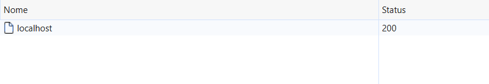
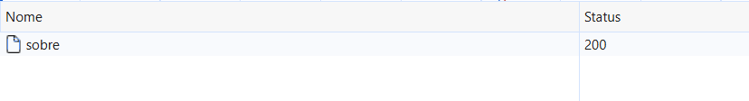
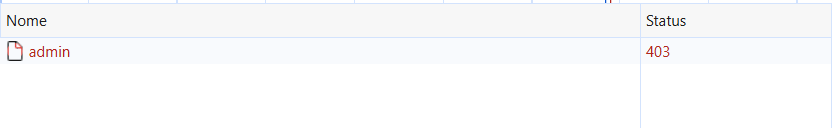
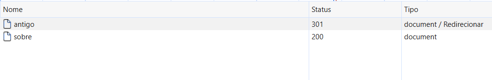
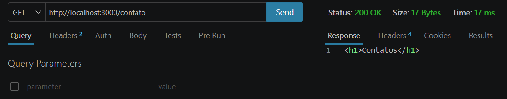
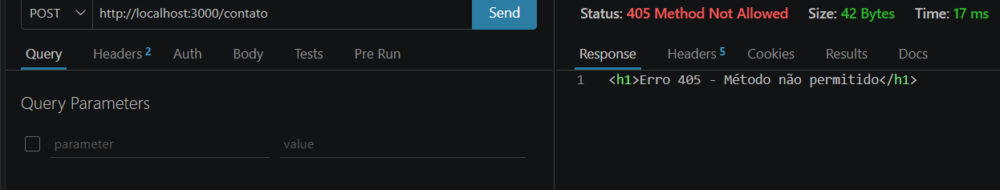
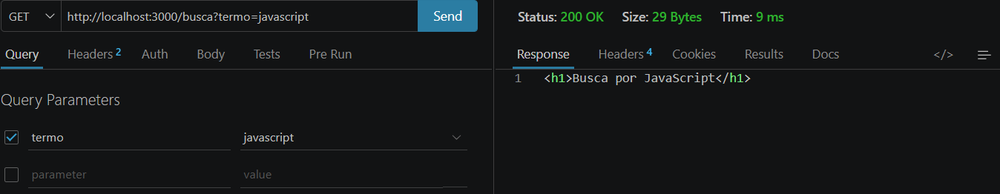
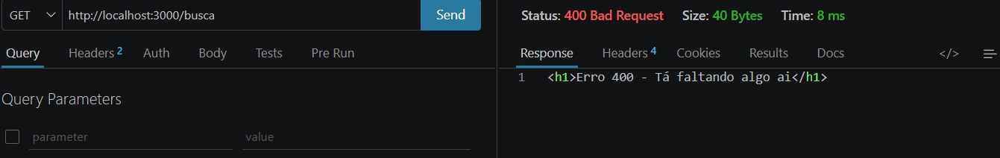
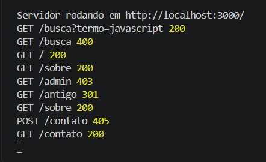

## Fundamentação

### HTTP 
#### Conversa entre cliente(navegador) e servidor(site). O cliente digita determinado URL para acessar tal site, ex: https://www.youtube.com/, fazendo assim uma REQUEST(Requisição) que é o pedido, e o Servidor responde o cliente com a resposta para o cliente, no meio disso, há o DNS(Domain Name System ou Sistema de Nomes de Domínios, que pega o URL digitado e transforma-os em números, conhecidos como Endereço IP, que facilita a compreensão do computador;

### MÉTODOS
* GET = Solicita/Recupera algo;
* POST = Posta/Cria algo novo;
* PUT = Atualiza determinadas informações existentes ou já registradas;
* PATCH = Aplica modificações parciais a um recurso;
* DELETE = Apaga algo.
##### link utilizado = https://developer.mozilla.org/pt-BR/docs/Web/HTTP/Reference/Methods

### Método seguro e idempotente:
#### Método seguro e idempotente HTTP = São aqueles que não alteram o servidor, exemplos de métodos seguros: GET, HEAD e OPTIONS, todos os métodos seguros são idempotentes, porém, nem todos idempotentes são seguros, como PUT e DELETE.
##### Link pesquisado: https://developer.mozilla.org/pt-BR/docs/Glossary/Safe

### Códigos de status
### Famílias:
* 100-199 = Respostas informativas;
* 200-299 = Respostas bem-sucedidas;
* 300-399 = Mensagens de direcionamento;
* 400-499: Respostas de erro do cliente;
* 500-599 = Respostas de erro do servidor.
### Exemplos
* 200 = Solicitação bem-sucedida;
* 201 = Requisição foi bem-sucedida e um novo recurso foi criado como resultado;
* 301 = URL alterada permanentemente, nova URL fornecida;
* 302 = URL modificada temporariamente, Servidor fornece um  URL substituto.
* 304 = É usado para fins de cache. Ele informa ao cliente que a resposta não foi * modificada, portanto, o cliente pode continuar a usar a mesma versão em cache da resposta;
* 400 = Servidor não pode ou não irá processar a solicitação devido a algo que é reconhecido como erro do cliente;
* 401 = cliente deve ser autenticado para acessar determinado conteúdo;
* 403 = Cliente não tem direito de acesso ao conteúdo, ou seja, não tem autorização (identidade reconhecida pelo servidor);
* 404 = Erro, página não achada;
* 405 = reconhecido pelo servidor, mas não suportado pelo recurso de destino;
* 500 = Servidor achou um erro que ele  não sabe lidar.
##### Link utilizado: https://developer.mozilla.org/pt-BR/docs/Web/HTTP/Reference/Status

### Diferenças 
#### 301 e 302 = No 301, o URL foi modificado para sempre, e no 302 foi modificada temporariamente; 401 e 403 = No 401, o cliente não está autenticado, na 403, ele é reconhecido, mas não tem acesso.

### Cabeçalhos
#### São heróis desconhecidos da World Wide Web (WWW). Eles são componentes essenciais do protocolo HTTP, que rege como os dados são transmitidos entre um navegador (cliente) e o servidor web.
##### Link utilizado: https://apidog.com/pt/blog/what-are-http-headers/
* Content-type = Tipo de mídia do corpo da resposta;
* Content-lenght = Tamanho do corpo da resposta em bytes;
* Location = URL para redirecionamentos;
* User-Agent = Identifica o software cliente;
* Accept = Tipos de mídias que o cliente pode processar;
* Allow = Lista um conjunto de métodos suportados pelo recurso, aparece junto do 405 method not allowed;
* Cache-control = Utilizado para especificar diretivas para mecanismos de cache tanto em respostas quanto em respostas, ele está junto do 304.
##### Links utilizados: https://nettool1.com/pt/blog/http-headers-guide.html | https://developer.mozilla.org/pt-BR/docs/Web/HTTP/Reference/Headers/

### HTTP é stateless?
##### Stateless significa protocolo sem estada, no caso, cada requisição é tratada de forma independente, exemplo = Você vai a uma cafeteria, pede um café e informa seu nome, o atendente vai entregar o café e esquece quem você é no mesmo instante.
Link utilizado: https://dev.to/0taviopascoal/stateless-vs-stateful-entenda-a-diferenca-de-uma-vez-por-todas-4b9b

### HTTP x HTTPS
#### Diferenças
##### HTTP significa Hypertext Transfer Protocol. É um protocolo de transferência que habilita a comunicação entre diferentes sistemas, transferindo dados e informações por uma rede;
##### HTTPS = HTTPS significa praticamente a mesma coisa, mas com uma camada a mais que é a de Segurança (Secure representada pelo "S" no final de HTTPS), ele trabalha para proteger os dados transportados na comunicação entre os sistemas.

## Prints e suas descrições

### Descrição = Status 200 na home indica que o servidor reconheceu e respondeu sem problemas

### Descrição = Status 200 no sobre indica que o servidor reconheceu e respondeu sem problemas

### Descrição = Status 403 na admin indica que o servidor não dá acesso aos dados e informações

### Descrição = Status 301 no antigo indica que essa página foi removida para sempre, assim, enviando o usuário para outro lugar, no caso para "sobre"

### Descrição = Status 200 indica que o servidor reconheceu e respondeu sem problemas

### Descrição = Status 405 indica que foi reconhecido pelo servidor, mas não suportado pelo recurso de destino

### Descrição = Status 200 indica que o servidor reconheceu e respondeu sem problema

### Descrição = Status 400 indica que tem algo faltando

### Descrição = No terminal, mostra o Cabeçalho, Rotas e os Status

## Conclusão
### Ao decorrer dessa pesquisa, descobri que um servidor é algo mais complexo do que eu mais pensava, alguns status mesme esquecidos, tem suas devidas importâncias, como exemplo as Famílias 4xx e 5xx, qeu apresentam erros de diferentes lados (Cliente e Servidor). Em relação aos servidores criados em aulas passadas, além dos status mais conhecidos (200 e 404), deve-se adicionar outros, como o 301(Acesso negado) e 400(Tá faltando algo).
